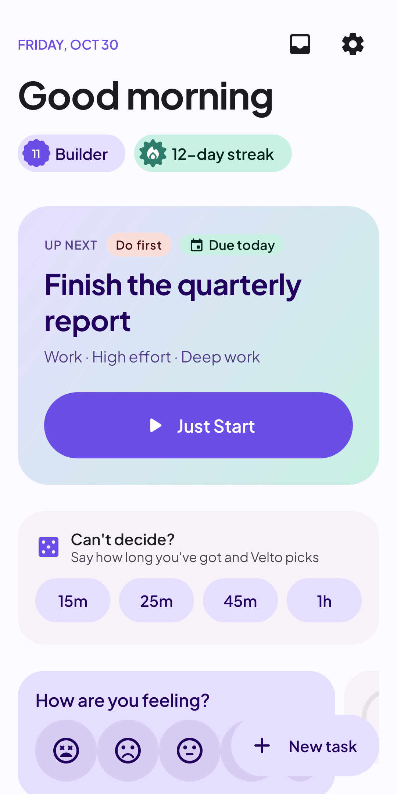
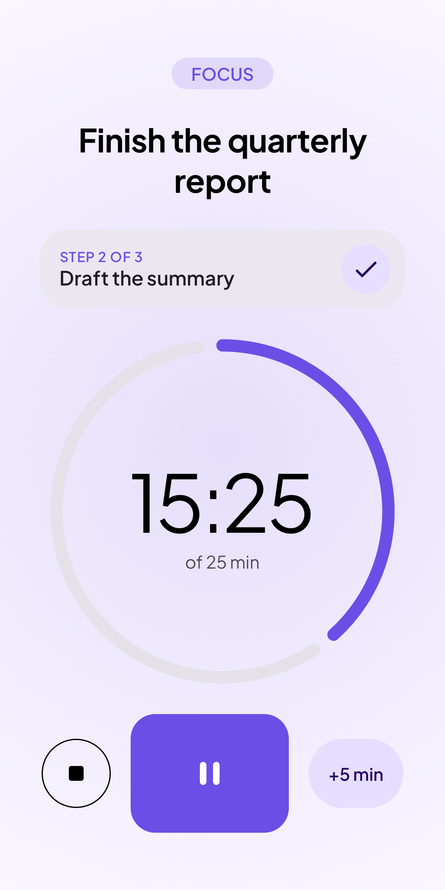
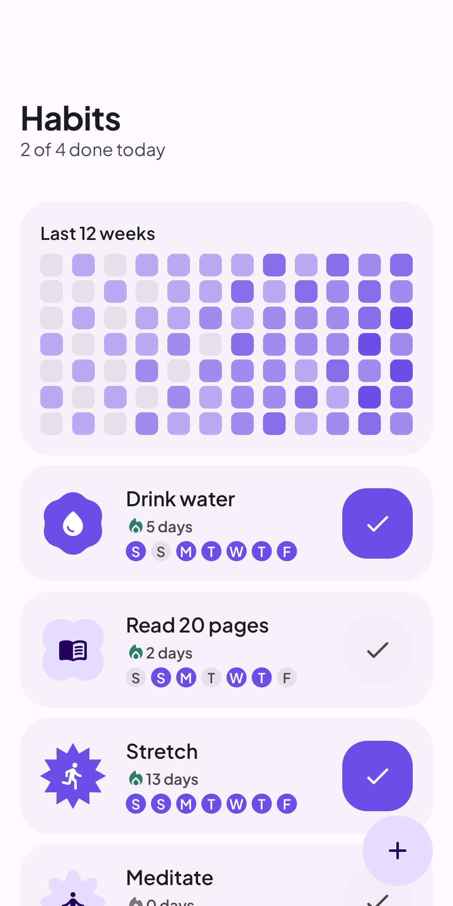
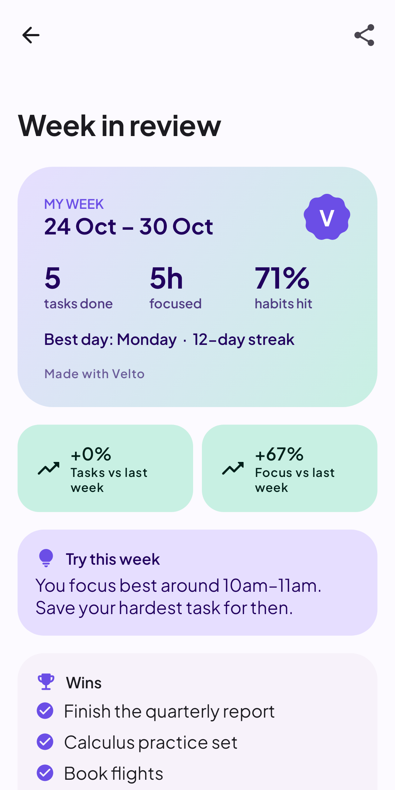

# Velto

[](https://github.com/Sukanth19/velto/actions/workflows/ci.yml)

**Stop deciding, start doing.** Velto is an Android productivity app that picks your next task and starts a focus timer, so you spend your energy on the work instead of the to-do list.

<p>
  
  
  
  
</p>

## Features

- **Just Start**: one tap ranks your tasks by urgency, importance, effort and energy, and starts a focus session on the best one
- **Pick for me**: say how long you've got and how much energy you have, and Velto spins up the best fit
- **Planning**: due dates that raise urgency as they get close, steps you tick off while focusing, repeating tasks, and a priority matrix
- **Focus**: a Material 3 Expressive wavy timer, +5 minutes, Do Not Disturb while focusing, and a Quick Settings tile
- **Habits**: daily check-ins, streaks and a 12-week grid
- **Inbox**: capture a thought in a tap, sort it into a task or habit later
- **Journal**: mood and energy check-ins, a year in pixels, and how energy relates to your focus
- **Week in review**: wins, trends against last week, your best focus hours and one suggestion, shareable as an image
- **Progress**: XP, levels, achievements and a plant that grows as you level up
- **Widgets**: next task, focus timer, today, top tasks, habits, mood, quick capture and level
- **Private**: no account, no tracking. Data stays on the phone, with export/import and Android backup. See the [privacy policy](docs/PRIVACY.md)

## Tech

Kotlin, Jetpack Compose with Material 3 Expressive, MVVM with a domain layer of use cases, Room, DataStore, WorkManager, Hilt and Glance widgets.

```
app/src/main/java/com/decisionexecution/app/
├── data/          Room entities and DAOs, repositories, backup, WorkManager workers
├── domain/        Models, repository interfaces, scoring and other pure logic, use cases
├── presentation/  One package per screen, plus widgets, navigation, theme and shared components
└── di/            Hilt modules
```

## Building

Needs JDK 17 and the Android SDK with platform 37. Open the project in Android Studio, or:

```bash
./gradlew assembleDebug        # debug APK in app/build/outputs/apk/debug
./gradlew assembleRelease      # signed if keystore.properties points at a keystore
```

Minimum Android version is 8.0 (API 26).

## Tests

```bash
./gradlew testDebugUnitTest
```

Unit and property tests (Kotest), Room migration tests against the exported schemas in `app/schemas`, and Robolectric tests that render every screen and save PNGs to `app/build/screenshots`. CI runs them on every push and pull request.

`-PpropIterations=500` runs the property tests with more iterations.

## Play Store assets

The listing text and images live in `fastlane/metadata/android/en-US`. The images are rendered from the app itself:

```bash
./gradlew testDebugUnitTest --tests '*StoreAssetsTest*' -PstoreAssets=true
```
